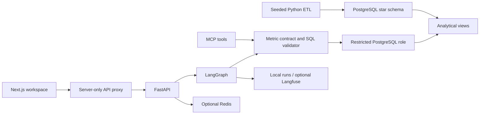

# Atlas — Commercial Intelligence Workbench

[](https://github.com/rajatmurhe/atlas-commercial-intelligence/actions/workflows/ci.yml)

An independent portfolio project for investigating commercial performance. **All data is synthetic.


[Business brief](docs/business-brief.md) · [Measured findings](docs/findings.md) · [Evaluation results](evals/results-guided-evidence.json)

## Current release

- Seeded 48-month pharmaceutical-style dataset, four fictional market portfolios, eight products, 16 territories, 32 reps, two channels.
- PostgreSQL star schema, atomic ETL, quality checks and run logging.
- Shared KPI views with sales aggregated before joining targets.
- Next.js/TypeScript overview, investigation, outlook, saved briefs, and data-trust screens.
- FastAPI protected by a server-side API key; session cookies keep conversations separate.
- LangGraph intent → SQL compilation → AST validation → restricted execution → evidence response.
- Guided deterministic planner works without model credentials. Optional structured OpenAI planner is implemented but has not yet been evaluated live.
- Three-second database query timeout, restricted read-only role, approved views and functions, 200-row cap.
- Seasonal naïve / ETS forecasting with a held-out test, sales-drop screen, and randomized synthetic promotion analysis.
- Local stdio MCP tools share the query validator. Optional Redis caching and Langfuse callback integration.

This is an initial local release, not the completed portfolio roadmap. Live-model benchmarks, hosted deployment, native Tableau validation, a recorded video and a real Langfuse screenshot remain to be completed. n8n manual execution is verified and its local schedule is published. Guided results must not be described as LLM accuracy.

## Local setup

Requires Python 3.11+, Node 20.9+, and PostgreSQL 16+ binaries.

```bash
python3 -m venv .venv
.venv/bin/pip install -r services/api/requirements.txt
npm ci --prefix apps/web
.venv/bin/python scripts/bootstrap.py
.venv/bin/python scripts/dev.py
```

Open http://127.0.0.1:3031. Bootstrap creates an isolated database on port 55433 and randomly generated credentials in ignored `.env`; it does not modify your default PostgreSQL server. Set `POSTGRES_BIN` if the PostgreSQL binaries are elsewhere. The local cluster is stored in `.runtime/postgres` and is intended for development only; use managed storage for deployment.

```bash
.venv/bin/pytest
npm run build --prefix apps/web
PYTHONPATH=services/api .venv/bin/python -m ciq.mcp_server
```

## Live model mode

Set `AGENT_MODE=live`, `OPENAI_API_KEY`, and `OPENAI_MODEL` in `.env`, then restart. Model choice is explicit, with no implicit paid fallback. `PROMPT_VARIANT=baseline` or `evidence` selects the planning prompt. The model extracts a typed analytical plan; deterministic SQL compilation limits the supported scope. This intentionally does not yet implement unrestricted model-generated SQL. Responses contain recorded token usage; pricing must be supplied before reporting dollar cost.

Set Langfuse credentials to enable remote graph traces. Without those credentials, successful, refused, clarified, and failed runs are recorded in PostgreSQL. A remote trace screenshot remains release work. Redis is optional and fails open to uncached reads.

## Metric contract

Revenue is synthetic reporting USD. Attainment = total actual / total target × 100. Gap = actual − target. Growth compares the same calendar months in the prior year. Portfolio share is not market share. Missing data and a true zero must never be treated interchangeably.

The target grain excludes reps. `v_sales_monthly` first aggregates reps and then joins targets, preventing inflated budgets. `v_performance` adds prior-year revenue at the same series grain.

## Analytical limitations

The generator contains a deliberate Kuwait oncology drop and a randomized promotion effect. These are simulations, not pharmaceutical market findings. The promotion experiment uses 16 randomized territories and an exact permutation test; its interval is an approximate Welch interval. Forecast selection uses a validation window; the final six months are held out for evaluation. Forecast residual bands are exploratory, not calibrated multi-horizon coverage. Sales-drop detection is a descriptive screen, not causal diagnosis.

The guided planner supports a bounded vocabulary and four reporting periods. Out-of-scope requests should clarify or refuse; benchmark expansion is needed to expose false acceptances. No rep-level performance conclusions should be drawn from territory aggregation. The API reserves global and per-session hourly investigation budgets atomically in PostgreSQL. Hosting still needs edge-level protection for other public endpoints.

## Architecture



## Next milestones

1. Expand the initial 60-case guided benchmark into a frozen development/held-out live-model benchmark.
2. Evaluate live prompt variants; publish real failures, latency, and token costs.
3. Expand clarification and temporal/filter coverage.
4. Exercise the deployment manifests and complete cloud release, with secret management and global quotas.
5. Validate the generated Tableau workbook in Tableau, observe a scheduled n8n run, and record the two-minute demo.

## Verified local release

On the local checkout, 19 backend tests pass and the Next.js production build passes. The guided regression benchmark passes 60/60 cases (median 638 ms; p95 1,347 ms). This measures deterministic regression accuracy, not LLM accuracy. See `evals/results-guided-evidence.json` for the full results.

HTTP smoke checks passed for the frontend, overview, chat, feedback, saved briefs, data quality, forecast/promotion analysis, API authentication, and weekly-report idempotency. The 12,288-row BI export reconciles Q3 revenue and target totals against the API. The ETL loaded 24,576 sales records and passed eight quality checks.

Browser desktop verification now covers the dashboard, investigation, SQL toggle and feedback. Responsive and keyboard checks are being recorded in `docs/evidence/browser-qa.md`. CI runs on every push and pull request.

## Release tooling added

- Dockerfiles and `compose.yaml`: PostgreSQL, Redis, one-time seed job, API and web. Start with `python3 scripts/compose_env.py`, then `docker compose --env-file .env.compose up --build`. The local Compose stack was built and passed HTTP checks for overview, chat, analytics and brief persistence.
- `infra/deploy-cloud-run.sh`: explicit project/region/runtime identity and Secret Manager references, private service by default. See `infra/README.md` for the remaining Vercel-to-GCP identity integration.
- `workflows/weekly-review.n8n.json`: importable, inactive Monday 08:00 Dubai workflow. Calls an idempotent endpoint that persists a weekly report in PostgreSQL.
- `scripts/export_bi.py`: complete shared-view export plus data-version manifest for Tableau. A generated TWBX package is included; native Tableau rendering remains unverified.
- `evals/run.py --mode live --variant baseline|evidence`: records scope/result accuracy, refusal precision/recall, clarification accuracy, latency and token usage. Optional `--input-price` and `--output-price` accept verified USD-per-million-token prices; unconfigured prices remain null.
- `scripts/compare_prompts.py`: runs both live prompts when credentials/model are configured. No live scores are fabricated.
- `docs/business-brief.md` and `docs/demo-script.md`: decision brief and two-minute recording script. A recorded video remains pending.

Current environment check: Vercel is logged out, gcloud is not installed, and the project's `.env` has no OpenAI model/key or Langfuse credentials. Cloud destinations have not been selected. These block live-model comparisons, remote traces and deployment, not local development.

Compose configuration, shell syntax, Python syntax, and workflow JSON validation also pass. Cloud hosting, remote traces, and live-model comparisons remain unverified. The initial [GitHub Actions run passed](https://github.com/rajatmurhe/atlas-commercial-intelligence/actions/runs/39217734387).

## Evaluation results and failure analysis

| Mode | Cases passed | Answer accuracy | SQL validity | Refusal precision / recall | Median / p95 |
|---|---:|---:|---:|---:|---:|
| Guided regression | 60 / 60 | 100% | 100% | 100% / 100% | 638 / 1,347 ms |
| Live baseline prompt | Not run | — | — | — | — |
| Live evidence prompt | Not run | — | — | — | — |

The guided suite has no failures on its bounded, development-visible cases. This is not a general language understanding score. It checks each returned revenue, target, gap, attainment and prior-year value against an independent Python oracle. Unsupported filters, paraphrases, and adversarial prompts require broader testing before a production claim. Live comparisons require credentials; `scripts/compare_prompts.py` only accepts fresh outputs and publishes all failed cases. Model token usage is zero in guided mode; unconfigured dollar cost is null, not an invented zero-cost cloud claim.

## Development location

Use a local checkout outside cloud-sync folders. Keep `.env`, database storage and dependencies outside source control. The bootstrap script creates a dedicated development database; it does not recover prior chat history.

Latest security release: [GitHub Actions passed](https://github.com/rajatmurhe/atlas-commercial-intelligence/actions/runs/39219806517), including 19 backend tests, the 60-case benchmark and the production build.
