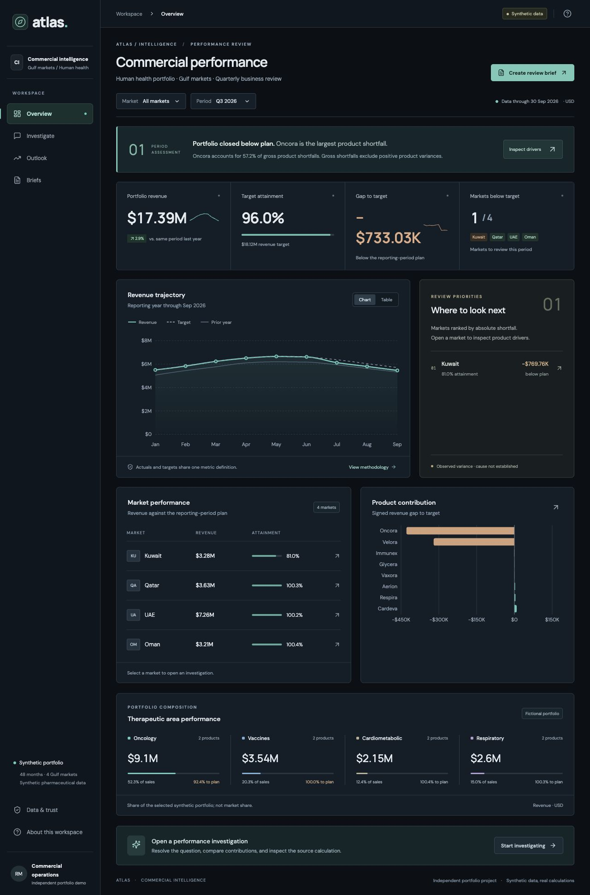
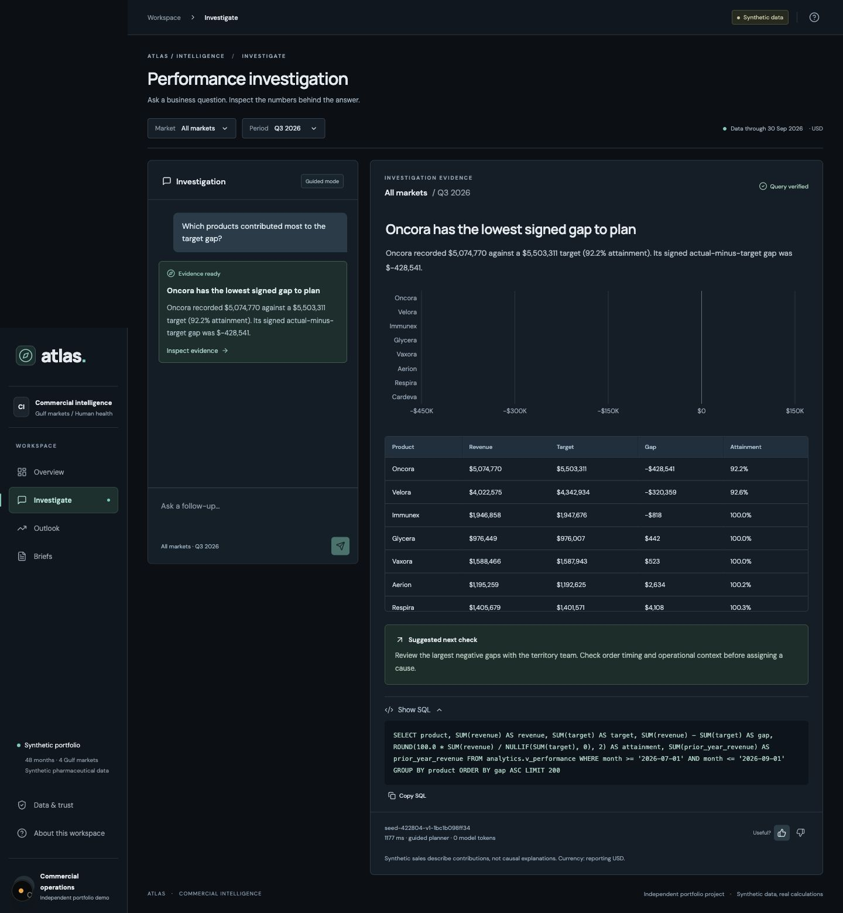
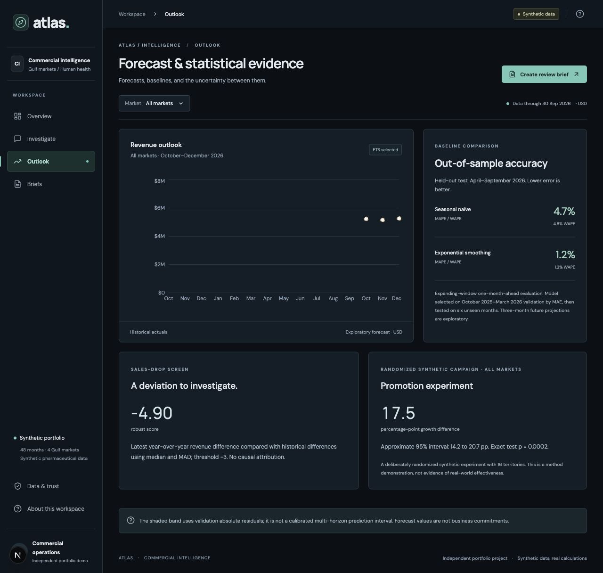
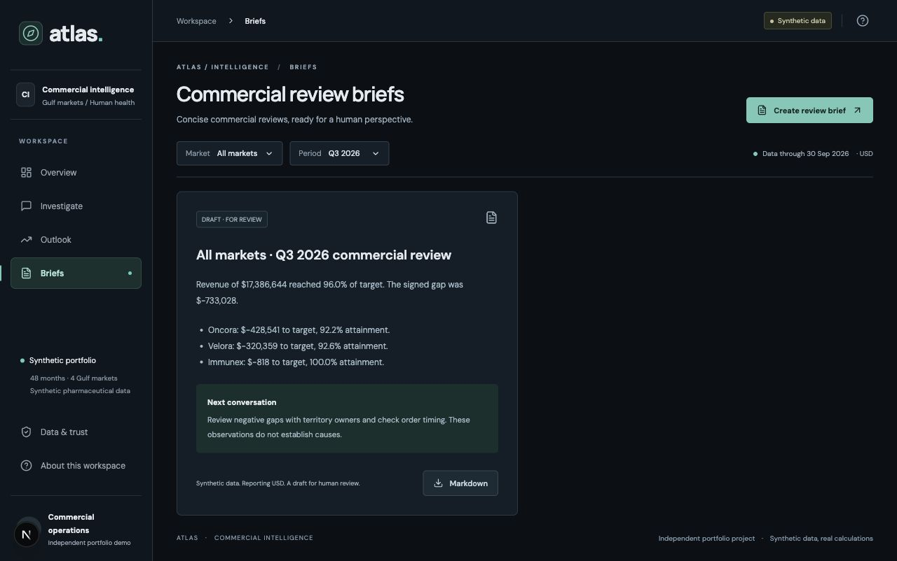
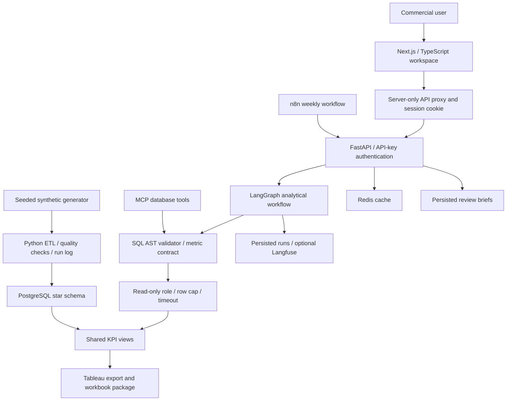

# Atlas: Commercial Intelligence & Evidence-Based Sales Analytics

[](https://github.com/rajatmurhe/atlas-commercial-intelligence/actions/workflows/ci.yml)


Atlas is a commercial operations workbench that connects **portfolio monitoring, conversational investigation, forecasting, and review briefs**. A business user can move from a missed target to the underlying numbers, inspect the SQL, and save a decision brief without switching analytical tools.

Built with **Next.js, TypeScript, FastAPI, PostgreSQL, and LangGraph**, the application shares one metric contract across its dashboard, agent, MCP tools, and BI export. Its graphite-and-teal interface prioritizes reporting context, readable evidence, and the next business decision.

> From “Where are we missing plan?” to an inspectable answer and a review-ready brief.

**All data is synthetic**, generated with a seeded Python script. Products and commercial outcomes are fictional. This independent portfolio project contains no patient, customer, or proprietary pharmaceutical data.

[Two-minute walkthrough](docs/demo/README.md) · [Business brief](docs/business-brief.md) · [Measured findings](docs/findings.md) · [Evaluation evidence](evals/results-guided-evidence.json) · [Release status](docs/evidence/release-status.md) · [Deployment guide](infra/README.md)

---

## The workspace

### Portfolio overview

Review revenue, year-over-year growth, target attainment, and product gaps within an explicit market and reporting period. The workbench helps commercial teams choose which exceptions deserve investigation.



### Conversational investigation

Ask supported sales questions, follow up in the same conversation, inspect the generated SQL, and give feedback. Answers retain the reporting scope and show numerical evidence instead of presenting an unexplained recommendation.



### Forecast and statistical evidence

Compare the selected forecast with a seasonal naïve baseline, review a sales-drop screen, and inspect the synthetic promotion experiment. Evaluation windows and statistical limitations remain visible beside the results.



### Commercial review briefs

Turn the selected market and period into a persisted draft containing revenue, attainment, the largest product gaps, and a proposed next check. Export Markdown for human review.



---

## Architecture



### Agent pipeline

```text
Question + conversation context
        │
        ▼
Classify scope ──────────► Clarify ambiguity / refuse unsafe requests
        │
        ▼
Typed analytical plan   ◄── Guided planner OR optional live model
        │
        ▼
Compile SQL from the shared metric contract
        │
        ▼
Parse AST → enforce approved views/functions → cap results
        │
        ▼
Execute through a restricted, read-only PostgreSQL role
        │
        ▼
Select chart + compose numerical insight → persist run and feedback
```

The live model extracts a **structured plan**; a deterministic compiler produces SQL. This bounds the query surface and preserves metric definitions. It is not unrestricted model-written SQL. The default guided mode runs without a paid model key; live mode is implemented but its external evaluation is pending.

## Key capabilities

### Reproducible data engineering

- **24,576 sales records**, covering 48 months from October 2022 through September 2026.
- Eight fictional products, four Gulf markets, 16 territories, 32 reps, and two channels.
- PostgreSQL sales and target facts with product, region, rep, date, and channel dimensions.
- Atomic ETL, eight data-quality checks, and persisted run logs.
- Targets exclude rep grain: sales are aggregated before targets are joined, preventing inflated budgets.

### Governed analytical access

- SQLGlot AST validation allows approved read-only queries, views, and functions.
- Database permissions provide a second boundary: read-only execution, a three-second statement timeout, and a 200-row result cap.
- Server-side API credentials, session-owned conversations and feedback, origin checks, and shared hourly investigation quotas.
- MCP tools expose query execution, table discovery, and KPIs through the same validation layer.
- Redis caches analytical reads and falls back to uncached execution when unavailable.

### Business metrics with explicit definitions

| Metric | Contract | Decision supported |
|---|---|---|
| Revenue | Synthetic reporting USD | Size portfolio and product contributions |
| Target attainment | Actual ÷ target × 100 | Prioritize gaps to plan |
| Signed gap | Actual − target | Quantify the size of an exception |
| Growth | Same calendar months, prior year | Separate performance changes from reporting-period differences |
| Portfolio share | Product revenue ÷ portfolio revenue | Understand sales concentration; this is not market share |

### Forecasts and statistical analysis

Model selection uses April 2025–March 2026 validation data; the April–September 2026 test period is held out. The table reports expanding-window, one-step forecasts on the synthetic all-market series.

| Method | Test MAPE | Test WAPE | MAE (reporting USD) |
|---|---:|---:|---:|
| Seasonal naïve | 4.70% | 4.83% | 299,351 |
| Selected ETS | 1.25% | 1.22% | 75,877 |

The selected model beats this baseline on this dataset. That result does not establish performance on real pharmaceutical sales or future horizons. Three-month outlook bands are exploratory, not calibrated prediction coverage.

The sales-drop screen flags the deliberately injected Kuwait exception. The synthetic promotion experiment estimates approximately **17.5 percentage points** of lift with an exact permutation test (**p ≈ 0.0002**) across 16 randomized territories. These results demonstrate analytical methods, not real-world treatment or commercial effectiveness. [Read the methods and decision implications](docs/findings.md).

## Evaluation and failure analysis

The **60-case golden set** compares returned numbers with an independent Python oracle computed from the seeded data. It checks revenue, targets, signed gaps, attainment, prior-year values, SQL validity, refusals, and clarification behavior. GitHub Actions runs the regression benchmark, backend tests, and production frontend build on every push and pull request.

| Mode | Cases passed | Result accuracy | SQL validity | Refusal precision / recall | Median / p95 latency |
|---|---:|---:|---:|---:|---:|
| Guided regression | 60 / 60 | 100% | 100% | 100% / 100% | 516 / 1,185 ms |
| Live baseline prompt | Not run | — | — | — | — |
| Live evidence prompt | Not run | — | — | — | — |

**These are deterministic regression results, not LLM accuracy.** The guided suite has no failures on its bounded, development-visible cases. Named product, therapy, channel, multi-country, and unsupported-period filters now trigger clarification, with regression tests for those boundaries. Unrecognized filters, temporal paraphrases, and adversarial requests still need broader coverage. The current benchmark is not a held-out generalization test.

The live comparison runner requires fresh outputs, records all failed cases and token usage, and accepts explicit token prices for cost reporting. No model scores or costs are fabricated. Guided mode uses zero model tokens; unconfigured dollar costs remain null. [Raw benchmark results](evals/results-guided-evidence.json).

## Technology stack

| Layer | Technologies |
|---|---|
| Frontend | Next.js, React, TypeScript, Recharts, Lucide |
| Backend | Python, FastAPI, Pydantic, Psycopg |
| Agent | LangGraph, structured OpenAI planner, SQLGlot, MCP |
| Data | PostgreSQL, seeded Python ETL, shared analytical views |
| Analytics | Seasonal naïve baseline, ETS, robust anomaly scoring, permutation testing |
| Operations | Redis, Docker Compose, GitHub Actions, n8n |
| BI and observability | Tableau export/package, local run logs, optional Langfuse |
| Deployment targets | Private GCP Cloud Run, Vercel, managed PostgreSQL; not deployed yet |

## Run locally

### Docker Compose

Requires Docker with Compose and Python 3.

```bash
git clone https://github.com/rajatmurhe/atlas-commercial-intelligence.git
cd atlas-commercial-intelligence
python3 scripts/compose_env.py
docker compose --env-file .env.compose up --build
```

Open **http://localhost:3032**. Compose starts PostgreSQL, Redis, the seed job, FastAPI, and the frontend. The setup script generates local credentials in ignored `.env.compose`. This is a synthetic development stack; do not expose it directly as a production service.

### Native development

Requires Python 3.11+, Node 20.9+, and PostgreSQL 16+ binaries.

```bash
python3 -m venv .venv
.venv/bin/pip install -r services/api/requirements.txt
npm ci --prefix apps/web
.venv/bin/python scripts/bootstrap.py
.venv/bin/python scripts/dev.py
```

Open **http://127.0.0.1:3031**. Bootstrap creates an isolated database on port 55433 and randomly generated credentials in ignored `.env`. Set `POSTGRES_BIN` if PostgreSQL binaries are elsewhere. Keep the checkout and `.runtime/postgres` outside cloud-sync folders.

### Validate the release

```bash
.venv/bin/pytest -q
.venv/bin/python evals/run.py
npm run build --prefix apps/web
.venv/bin/python scripts/smoke_web.py --origin http://localhost:3032
```

### Enable optional integrations

Set `AGENT_MODE=live`, `OPENAI_API_KEY`, and an explicit `OPENAI_MODEL` in your local environment, then restart. `PROMPT_VARIANT=baseline|evidence` selects the planning prompt. Configure Langfuse credentials for remote graph traces. Never commit credentials.

```bash
# Compare live prompts after configuring credentials/model
.venv/bin/python scripts/compare_prompts.py

# Start the local stdio MCP server
PYTHONPATH=services/api .venv/bin/python -m ciq.mcp_server
```

[Cloud deployment and identity setup](infra/README.md) · [n8n workflow](workflows/README.md) · [Tableau package](bi/README.md)

## Repository guide

```text
apps/web/          Next.js commercial workbench and server proxy
services/api/      FastAPI, agent graph, SQL validation and analytics
scripts/           Bootstrap, deployment checks, BI export and smoke tests
evals/             Golden cases, independent oracle and measured results
bi/                Shared-view CSV export and generated Tableau package
workflows/         Weekly n8n review workflow
infra/             Cloud Run deployment and Vercel identity instructions
docs/              Business brief, findings, design decisions and evidence
```

## Verification and remaining release work

**Verified:** 30 backend tests; 60 guided regression cases; production frontend build; HTTP checks for overview, investigations, feedback, saved briefs, analytics, authentication, origin rejection, and session isolation. BI totals reconcile with the API. Actual application screenshots are included above.

**Implemented, awaiting external verification:** live-model prompt comparison and Langfuse traces, GCP/Vercel/managed PostgreSQL deployment, and native Tableau rendering. The n8n report node has executed successfully and the weekly schedule is published; unattended execution is not yet verified. A two-minute narrated screenshot walkthrough is included; a live interaction recording remains pending.

The project is a working local portfolio application, not a completed hosted production release. See the [release evidence](docs/evidence/release-status.md) for exact verification boundaries.

## Limitations

- Synthetic patterns are deliberately injected and must not be represented as MSD findings.
- Guided questions use a bounded vocabulary and four supported reporting periods; arbitrary filters and unrestricted SQL generation are not supported.
- Territory aggregates do not justify individual rep-performance conclusions.
- Promotion inference uses a small synthetic randomized experiment; forecast intervals are exploratory.
- Cloud security, remote observability, native BI rendering, and live-model behavior require their own deployment validation.
- Review briefs propose checks for a human decision maker; they do not establish causes or prescribe commercial actions automatically.
